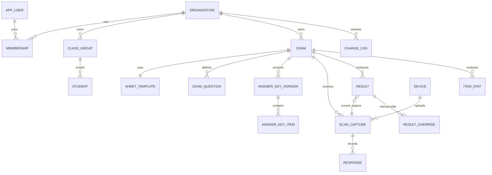

# EvalBee Teardown & OMR Platform Architecture Blueprint

_Analysis date: 2026-11-10. Target: `https://evalbee.com/` (marketing site and teacher web portal share one origin)._

## 0. Method, evidence and limits

| What | How |
|---|---|
| Page load, network capture | Headless Chromium (Playwright); 58 same-origin requests captured |
| Full client bundle | All 69 webpack chunks resolved from the runtime chunk map and downloaded (6.9 MB JS) |
| Static analysis | REA `analyze-javascript-application`: 68 JS files parsed, 828 modules, 1.23 M AST nodes, 8,335 findings; plus manual reading of formatted source |
| OpenCV build | `/zz0.js` fetched (11.45 MB UMD build of OpenCV.js, WASM embedded) |

**Not done (by design):** no login, no form submission, no calls to authenticated APIs, no scan uploads. So **server responses, server-side grading code, and the Android/iOS apps were not observed**. Anything marked _(inferred)_ comes from naming or client behaviour, not from server code. `partner.evalbee.com` was not loaded (host not allowed in this environment).

---

## 1. Extracted technical stack & endpoint map

### 1.1 Client stack (observed)

| Layer | Finding | Evidence |
|---|---|---|
| Framework | React 18.3.1, Create React App (webpack 5) build, code-split per feature (`exams`, `reports`, `students`, `attendance`, `question-banks`, `payment`, `admin`, `settings`, `teams`, `auth`, `online-exam`, `recycleBin`) | `static/js/main.*.js`, CRA manifest, `webpackChunkevalbee_web` |
| UI kit | MUI (Material UI) + custom CSS | `MuiButton` etc. |
| State | **zustand** stores (e.g. scan store: `images`, `scanResults`, `cornerPos`, `scanTempalate` [sic], `localEdits`, `rotateValue`) | module `39298` `create()` pattern |
| Forms | react-hook-form (`register/setValue/watch/getValues`) | exam creation wizard |
| i18n | i18next (all messages keyed, e.g. `corner_not_found_msg`) | |
| Computer vision | **OpenCV.js** loaded lazily from `/zz0.js` (renamed file), `cv.onRuntimeInitialized` guard | module `78258` |
| Homography math | `perspective-transform` npm package (uses `numeric.js`) | module `12752` |
| Canvas editing | **Konva 9.3.14** (react-konva): draggable corner/crop handles over scan images | chunk `7706` |
| PDF viewing | pdfjs-dist 4.10.38 (chunk `7706`) and 3.11.174 via react-pdf (chunk `9031`) - viewing PDFs (question papers / generated sheets), **not** generating them | |
| PDF generation | **Server-side.** No jsPDF/PDFKit/pdf-lib in bundle; sheets come from `GET api-online/exams/{id}/answersheet-pdf?sheetPerPage=` and async `prefilled-answer-sheet-job` | route table |
| Rich text / math | Lexical editor, MathJax 3 from jsDelivr (mhchem, enclose) | question banks |
| Spreadsheets | SheetJS (`XLSX`) for roster/report import-export | |
| Realtime | STOMP over SockJS: `wss://evalbee.com/ws-api-online`, `/ws-api-upastify`; topics `/topic/background-task/`, `/topic/exam-documents/jobs/`, `/topic/device-user-update/`, `/topic/temp-user-upate-log/` | chunk `5644` |
| Workers | No Web Worker for CV - OpenCV runs on the main thread | `new Worker` only in pdf.js / vendor code |

### 1.2 Backend & third parties

| Concern | Finding |
|---|---|
| Hosting / origin | Everything on `https://evalbee.com` behind path-prefixed services: `api/` (core OMR), `api-online/` (online exams, question banks, branding, jobs), `api-ums/` (users, subscriptions, payments), `api-upastify/` (attendance, biometric devices), `api-auth/` (OAuth client admin, separate URL) |
| Server tech | _(inferred)_ Java/Spring Boot microservices: STOMP+SockJS, `*Dto` naming everywhere, path-prefixed gateway |
| Auth | **Firebase Auth** (project `omrevaluator`): passwordless **email link** (`sendSignInLinkToEmail`, continue URL `https://evalbee.com/verify`), **phone OTP** (`signInWithPhoneNumber` + reCAPTCHA), and **custom tokens** (`signInWithCustomToken`) minted by the backend after `no-auth-api/create-email-otp` → `verify-email-otp` (white-label/student flow) and `exam-custom-token` (student exam links) |
| API auth header | `x-user-token: <Firebase ID token>` on every call (no cookies, no Bearer) |
| Response obfuscation | `/e/` endpoints return AES-GCM ciphertext; the key is derived client-side from a SHA-256 of ids + a seed **shipped in the bundle**. That is obfuscation (anti-scraping of question banks), not security |
| Storage | Google Cloud Storage buckets: `evalbee-scan-images`, `evalbee-brand-images`, `evalbee-question-papers`, `evalbee-documents`, `upastify-documents`, `upastify-user-biometric`. Scan images are uploaded with **signed PUT URLs** (`.../sheet-image/put-url`) |
| Payments | **Razorpay** Checkout (`checkout.razorpay.com/v1/checkout.js`, live key in bundle); order → `api-ums/web/payment/purchase-orders`, verify → `api-ums/web/payment/verify`. INR + USD price list |
| Messaging | Prepaid "message account" credits (`api-ums/web/message-account`, `message-buy-link`); WhatsApp is surfaced in UI; **tenant SMTP** config + verify (`api-online/configuration/settings/smtp`) for report email. SMS/WhatsApp provider not visible client-side |
| Integrations | Outbound **Sync API** webhook per org (`configuration/settings/sync-api` + generated token + URL verify) - pushes results to customer systems |
| AI | OpenRouter (BYO key) and `open-ai/image-ocr`, `solution-from-image`, `solution-from-text` for question authoring |
| Support / analytics | Tawk.to chat, Google Analytics 4 (`G-ZBJPF99RT7`), Firebase Analytics events (`SinglePageScanWeb`, `SinglePageScanWebError`, `WEB_OUT_OF_STORAGE`, ...), `ipapi.co` geo lookup (currency selection) |
| Multi-tenancy / white-label | Tenant resolved **by domain**: `no-auth-api/tenant-theme?domain=`, `brand-logo/`, `tenant-support-contact?domain=`; per-host loader colour cached in `localStorage`; separate partner portal `partner.evalbee.com` |

### 1.3 Plans, roles and payload shapes

Public price list (`GET api-ums/web/v2/payment/products`, unauthenticated, observed):

```json
[{"productType":"PROFESSIONAL","price":[{"currency":"INR","price":590.0},{"currency":"USD","price":6.0}]},
 {"productType":"ENTERPRISE","price":[{"currency":"INR","price":472.0},{"currency":"USD","price":5.0}]},
 {"productType":"WHITE_WEB","price":[{"currency":"INR","price":5000.0},{"currency":"USD","price":60.0}]},
 {"productType":"WHITE_ANDROID","price":[{"currency":"INR","price":10000.0},{"currency":"USD","price":120.0}]},
 {"productType":"WHITE_IOS","price":[{"currency":"INR","price":10000.0},{"currency":"USD","price":120.0}]}]
```
(Billing period/unit is not in the payload.)

Subscription object fields used by the client: `accountType` (`FREE | PROFESSIONAL | ENTERPRISE`), `productType`, `isActive`, `startDate`, `endDate`, `expiryDate`, `storage`, `storageCount{usedSpace,totalSpace,availableSpacePercentage}`, `storageExpDate`, `credits`, `messageCredits`, `orgId`, `tenantId`, `role`.
Gates seen in code: **cloud image sync requires `ENTERPRISE`**; storage quota warnings at ≤20% free. Org roles: org admin + `TEACHER`; separate student portal (`/student/*`) and super-admin (`/admin`, partner credits/discounts, tenants, white-label bookings).

### 1.4 Endpoint map (OMR-relevant subset; 256 routes extracted in total)

| Purpose | Method / path |
|---|---|
| Create exam | `POST api/web/exams/exam` body: `{rollDigits, examSets, subjects[{subName, sections[]}], examName, classNames, examDate, onlineMode, onlineSettings, templateParams}` |
| Copy exam | `POST api/web/exams/exam/copy` |
| **Scan template** (bubble coordinates) | `GET api/exam/{examId}/scan-template` |
| Edit template | `GET api/exam/{examId}/edit-template`, `POST api/exam/edit-template` |
| Template params / label profile | `GET api-online/exams/{id}/template-params`, `GET api/web/exams/{id}/label-profile` |
| Header / label profiles | `GET/POST api-online/configurations/header-profile(s)`, `.../label-profile(s)` |
| Answer sheet PDF | `GET api-online/exams/{id}/answersheet-pdf?sheetPerPage=n`; prefilled sheets: `POST .../prefilled-answer-sheet-job` → `GET .../download-jobs` → `GET api-online/jobs/{jobId}` |
| Answer key | `GET/POST/DELETE api/web/exams/{id}/exam-key` |
| **Submit scan results** | `POST api/exam/scan-results` body: `{examId, resultScanTemplates:[{pixels:[[0/1]], roll:[[0/1]], examSet:[0/1]}]}` |
| Image upload | `GET api-online/exam/{examId}/{rollNo}/sheet-image/put-url` → PUT to GCS → `POST api/sync/exams/{examId}/sheet-images/{rollNo}/{page}` |
| Image sync setting | `GET/POST api/web/exams/{id}/settings/sync-images` |
| Review overlay | `GET api/exams/{id}/reports/{roll}/scan-overlay/{page}`, `POST .../generate-overlay` |
| Option-area crop (zoom per question) | `GET api/web/teacher/exams/{id}/option-area-template/{roll}` |
| Manual edit of a result | `GET/POST api/web/teacher/exams/{id}/reports/{roll}/edit` |
| Roll numbers already scanned | `GET api/web/teacher/exams/{id}/roll-numbers` |
| Reports | `.../student-reports`, `.../student-report/{roll}`, `.../details/marks-distribution`, `.../analysis/response-analysis`, `.../exports/excel-data`, `api-online/report/{id}/...` (PDF), `.../student-report-job` |
| Subjective marks | `.../student-report/{roll}/subjective-marks`, bulk `.../student-reports/subjective-marks` |
| Dashboards | `api-online/dashboard-api/cumulative-report-data`, `.../reports/progressive-report-data` |
| Students / classes | `api-online/web/students`, `students/search`, `v2/student`, `class-list` |

Question types: `TRUEORFALSE, THREEOPTION, FOUROPTION, FIVEOPTION, SIXOPTION, EIGHTOPTION, TENOPTION, MATRIX (primaryOptions × secondaryOptions), DECIMAL (digits, hasNegativeSign, decimalAllowed)`.
Section fields: `noOfQue, type, positiveMark, negetiveMark [sic], partialAllowed, optionalAllowed, noOfOptionalQue, optionalType (Default | Max Marks | Min Marks)`.

### 1.5 How EvalBee's web scanner actually works (chunk `6875`, module `50086`)

1. Image is resized so the short side is 1280 px (`INTER_AREA`), optional rotation via `warpAffine`.
2. Grayscale → `GaussianBlur 5×5` → **global Otsu threshold**.
3. User drags 4 crop corners (Konva) stored as **percentages** `{x1,y1,x2,y2}`; in a window of `min(w,h)/5` around each, it searches contours (`MORPH_CLOSE` → `Canny 50/100` → `findContours`) for a square blob (aspect 0.8-1.2, size between ½ and 2× expected mark size), picking the blob closest to the respective corner. Missing → `corner_not_found_msg`.
4. Global homography from template grid corners → detected corners.
5. **Timing-mark grid:** the template has a grid of reference marks (one row every 5 bubble rows). Each mark is re-located locally; if < 80% are found dark → `marker_grid_not_match_msg`.
6. **Piecewise homography:** one perspective transform per grid cell (4 surrounding marks). Each bubble is stored as `[y, x, cellRow, cellCol]` and mapped through its own cell's transform. This is how they absorb paper curl and lens distortion.
7. Fill test: 9 sample pixels (centre + 8 points at ±d/6) on the binary image; **filled if > 5 of 9 are black**.
8. Validation: multiple marks in a roll column, zero/multiple exam-set marks → `status: conflict`. Roll = column-wise digit decode with `rollStartDigit`.
9. Only the 0/1 matrices go to the server; **the server grades** against the answer key. A duplicate roll number is flagged `toBeOverride` instead of silently replacing.

Weak points worth beating: global Otsu (shadows), 9-point binary fill (no erasure/partial-fill grading, no confidence), CV on the UI thread, no QR page identity.

---

## 2. OMR coordinate & vision pipeline specification

### 2.1 Design principle

A single **Template JSON** is the source of truth. A deterministic **layout engine** turns sheet parameters into the template, then the **PDF renderer** draws from the template and the **scanner** reads from it. Neither consumer computes its own coordinates, so they cannot drift. No ML model is needed: geometry plus a fill classifier.

### 2.2 Coordinate system

- Units: **millimetres** in "sheet space", origin at the **centre of the top-left fiducial**, +x right, +y down. Fiducial-relative coordinates make the PDF margin and printer offset irrelevant.
- Page metadata keeps the physical page size and the fiducial offsets so the renderer can place everything.
- Every page carries a QR code: `{t: templateId, h: templateHash[0:8], p: pageIndex, e: examId?}`.

### 2.3 Template schema (v1)

```jsonc
{
  "$schema": "https://yourapp.dev/schemas/omr-template.v1.json",
  "templateId": "tpl_01J...",            // UUIDv7
  "version": 3,                           // bump on any geometry change
  "hash": "sha256:9f2c...",               // over canonical JSON of pages[]; scanner cache key
  "units": "mm",
  "page": { "size": "A4", "widthMm": 210, "heightMm": 297, "orientation": "portrait" },
  "fiducials": {
    "shape": "square", "sizeMm": 6.0, "fill": "solid",
    // centres, sheet space (TL is the origin by definition)
    "points": { "tl": [0, 0], "tr": [178, 0], "br": [178, 265], "bl": [0, 265] },
    "pageOffsetMm": [16, 16]              // TL fiducial centre on the physical page
  },
  "timingGrid": {                          // optional: enables piecewise warp (curl correction)
    "markSizeMm": 3.0,
    "rowsY": [0, 22.5, 45, 67.5],          // mark centres; one row per N bubble rows
    "colsX": [0, 44.5, 89, 133.5, 178],
    "minDetectRatio": 0.8
  },
  "bubble": { "shape": "circle", "diameterMm": 4.2, "innerSampleRatio": 0.7, "strokeMm": 0.25 },
  "qr": { "xMm": 150, "yMm": 2, "sizeMm": 18, "payload": "t=tpl_01J...&h=9f2c&p=0" },
  "regions": [
    {
      "id": "roll", "kind": "ID_GRID", "label": "Roll Number",
      "digits": 5, "symbols": ["0","1","2","3","4","5","6","7","8","9"],
      "orientation": "COLUMN_PER_DIGIT",
      "bbox": [4, 30, 32, 52],              // x, y, w, h (mm) - for crops/overlays
      "cells": [                             // cells[digit][symbol] = [cx, cy]
        [[6.0, 34.0], [6.0, 39.0], ...],
        ...
      ]
    },
    { "id": "set", "kind": "SET_SELECTOR", "options": ["A","B","C","D"], "cells": [[40,34],[46,34],[52,34],[58,34]] },
    {
      "id": "q", "kind": "MCQ_BLOCK",
      "questions": [
        { "no": 1, "type": "MCQ", "options": ["A","B","C","D"],
          "cells": [[50.0, 70.0], [56.0, 70.0], [62.0, 70.0], [68.0, 70.0]],
          "labelAt": [44.0, 70.0] },
        ...
      ]
    },
    { "id": "m1", "kind": "MATRIX", "questionNo": 101,
      "rows": ["A","B","C","D"], "cols": ["P","Q","R","S","T"],
      "cells": [[[x,y], ...5], ...4] },
    { "id": "n1", "kind": "NUMERIC_GRID", "questionNo": 102,
      "columns": 5, "symbols": ["-", ".", "0","1","2","3","4","5","6","7","8","9"],
      "signColumn": true, "decimalColumn": true,
      "cells": [[[x,y], ...12], ...5] }
  ]
}
```

Rules:
- `cells` hold **bubble centres** only; the scanner derives each sample box as a square of side `diameterMm` centred on the point, which keeps the JSON compact. 100 MCQs × 4 options ≈ 400 points ≈ 12 KB gzipped below 2 KB.
- Questions are addressed by `no`. The answer key lives elsewhere and references `(templateId, questionNo)`, so changing a key never changes geometry.
- `hash` is computed over canonical JSON (sorted keys, fixed decimals). Scans store the template hash they were read with.

### 2.4 Layout engine (generator side)

Input: `{pageSize, questions:[{type, options}], columns: 2, rollDigits: 5, sets: 4, header: {...}}`.
1. Reserve header band (school logo, exam name, student-name box), QR, ID grid and set selector at the top.
2. Flow questions into `columns` columns; row pitch = `bubble.diameterMm + 1.6`, option pitch = `diameterMm + 1.8`; insert a timing row every 5 question rows (EvalBee uses 5); paginate when a column overflows.
3. Emit Template JSON, then render the PDF from it (server: PDFKit or pdf-lib; vector circles and option letters inside bubbles at about 6 pt). Fiducials are solid squares; keep a 3 mm quiet zone around them.
4. Golden test: rasterise the PDF at 150 dpi, run the scanner on the clean image with a synthetic key, and expect 100% exact positions. This runs in CI for every layout change.

### 2.5 Vision pipeline (runs in a Web Worker with OpenCV.js; same TS code in the Capacitor mobile app)

**Step 0 - Normalise input.** Decode, apply EXIF orientation, resize so the long side is 2000 px (`INTER_AREA`), convert to grayscale. Reject on blur: if `variance(Laplacian) < τ_blur` (about 60 at this scale), ask for a retake.

**Step 1 - Find the 4 fiducials.**
1. `adaptiveThreshold(gray, ADAPTIVE_THRESH_GAUSSIAN_C, THRESH_BINARY_INV, block = odd(≈ 2.5 × expected fiducial px), C = 10)`.
2. `findContours(RETR_EXTERNAL)`. For each contour: `approxPolyDP(ε = 0.04·perimeter)` must give 4 vertices, be convex, and have solidity (area / hull area) > 0.9 and aspect 0.8-1.25. Area must fall within [0.3, 3] × the expected area, estimated as image width / sheet width × size.
3. Candidate centre = centroid from `moments` (sub-pixel).
4. Choose the 4-tuple that maximises quadrilateral area while matching the template aspect ratio within ±8%. Order corners by `x+y` (TL min, BR max) and `y−x` (TR min, BL max), the same trick EvalBee uses.
5. If the QR decodes (zxing-wasm), use its corner geometry as a fallback to predict fiducial windows and to fetch the right template by `t`/`h`/`p`.

**Step 2 - Perspective warp / curl correction.**
1. `H0 = getPerspectiveTransform(templateFiducials → imageFiducials)`.
2. If `timingGrid` exists: project each mark with `H0`, search a window of 1.5 × mark size for a dark square blob, and refine its centroid. Require ≥ `minDetectRatio` found.
3. Global refine: `findHomography(allMatches, RANSAC, 3px)`.
4. Local refine (curl): for each grid cell, compute `H_cell` from its 4 corner marks (EvalBee's approach), or fit a thin-plate spline through all marks for smoother results. Bubble centres map through `H_cell` of the cell containing them. Do not warp the whole image; map points only, which is cheaper and avoids resampling blur.
5. Quality gate: mean reprojection error of the marks must be < 0.25 × bubble radius, otherwise the result is "needs retake".

**Step 3 - Lighting normalisation (shadows, uneven classroom light).**
- Background flattening: `bg = morphologyEx(gray, MORPH_CLOSE, ellipse(k ≈ 3 × bubble px))` (or a large-σ Gaussian), then `norm = gray / bg × 255`. This removes gradients and shadows while keeping pencil marks.
- Optional CLAHE (`clipLimit 2.0`, tile 8×8) for very low contrast.
- Classify on `norm` (continuous values), not a hard binary image.

**Step 4 - Fill measurement and decision.**
For each bubble centre `p` with radius `r` in pixels:
1. `fill = mean(255 − norm)` over an inner disc of radius `0.7r` (precomputed mask, excludes the printed outline), divided by 255, giving 0-1. Also compute `ringBg` = median darkness of an annulus at 1.3-1.6r for local contrast: `score = clamp((fill − ringBg) / (1 − ringBg))`.
2. **Sheet-adaptive threshold:** collect all `score`s on the sheet (typically bimodal); `T = Otsu(scores)` clamped to [0.30, 0.60]. Use `T_hi = T + 0.10` and `T_lo = T − 0.10`.
3. Per question (option set `S`):
   - `marked = {o : score_o ≥ T_hi}`; `ambiguous = {o : T_lo ≤ score_o < T_hi}`.
   - **Single:** |marked| = 1 and the best is ≥ 1.6 × the second → answer, confidence = margin.
   - **Multiple:** |marked| ≥ 2 → `MULTI` (graded per policy; flagged).
   - **Erasure:** a bubble in the ambiguous band next to a clear mark → choose the clear mark and attach an `ERASURE_SUSPECTED` flag (lower confidence). Ambiguous only, no clear mark → `NEEDS_REVIEW`.
   - **Blank:** all < `T_lo`.
   - **Partial fill:** a score between `T_lo` and `T_hi` with no competitor is treated as marked only when ≥ `T` and flagged `LOW_CONFIDENCE`.
4. ID grid: the same rules per digit column; any non-single column → roll `CONFLICT` (as EvalBee does). Numeric grid: per column, sign/decimal columns are optional.
5. Output per sheet: `{templateHash, pageIndex, warpError, threshold, responses:[{q, marks:bitmask, scores:[...], flags:[...], conf}], roll, set, overlayPng?}`. Store the **bitmask + scores**, never just the letter, so policies can change later without rescanning.

**Performance budget (mid-range Android, 2000 px):** fiducials 40 ms, warp/grid 20 ms, 400 bubbles 15 ms, about 100 ms per sheet. Batch mode processes images in a worker pool sized to `navigator.hardwareConcurrency − 1`.

---

## 3. Database & offline-sync architecture

### 3.1 ER diagram



### 3.2 PostgreSQL schema (core)

```sql
-- tenancy
create table organization (id uuid primary key, name text not null, domain text unique,
  plan text not null default 'FREE' check (plan in ('FREE','PROFESSIONAL','ENTERPRISE','PARTNER')),
  branding jsonb not null default '{}', created_at timestamptz not null default now());
create table app_user (id uuid primary key, email citext unique, phone text, auth_uid text unique not null);
create table membership (org_id uuid references organization, user_id uuid references app_user,
  role text not null check (role in ('OWNER','ADMIN','TEACHER','VIEWER')), primary key (org_id, user_id));
create table device (id uuid primary key, user_id uuid references app_user, platform text, last_seen timestamptz);

-- roster
create table class_group (id uuid primary key, org_id uuid not null references organization, name text not null,
  unique (org_id, name));
create table student (id uuid primary key, org_id uuid not null, class_id uuid references class_group,
  roll_number text not null, full_name text not null, email text, guardian_phone text,
  updated_at timestamptz not null default now(), deleted_at timestamptz,
  unique (org_id, class_id, roll_number));

-- exam & geometry
create table sheet_template (id uuid primary key, org_id uuid not null, version int not null,
  hash text not null unique, params jsonb not null, geometry jsonb not null,
  created_at timestamptz not null default now());
create table exam (id uuid primary key, org_id uuid not null references organization,
  template_id uuid not null references sheet_template, name text not null, exam_date date,
  roll_digits smallint not null, set_count smallint not null default 1,
  active_key_version int, status text not null default 'DRAFT',
  row_version bigint not null default 1, updated_at timestamptz not null default now(), deleted_at timestamptz);
create table exam_question (exam_id uuid references exam, question_no int, section text, subject text,
  qtype text not null,            -- MCQ|TF|MATRIX|NUMERIC
  option_count smallint not null, -- matrix: rows*cols
  primary key (exam_id, question_no));

-- answer keys: immutable versions, one active
create table answer_key_version (exam_id uuid references exam, version int, set_index smallint not null default 0,
  created_by uuid references app_user, created_at timestamptz not null default now(), note text,
  primary key (exam_id, version, set_index));
create table answer_key_item (exam_id uuid, version int, set_index smallint, question_no int,
  correct_mask int not null,              -- bit i = option i correct (multi-correct allowed)
  marks numeric(6,2) not null default 1, negative numeric(6,2) not null default 0,
  policy text not null default 'EXACT'    -- EXACT | ANY_CORRECT | PARTIAL | BONUS | DROPPED
         check (policy in ('EXACT','ANY_CORRECT','PARTIAL','BONUS','DROPPED')),
  numeric_value numeric, numeric_tol numeric,
  primary key (exam_id, version, set_index, question_no),
  foreign key (exam_id, version, set_index) references answer_key_version);

-- scanning: append-only captures, never updated after insert
create table scan_capture (id uuid primary key,          -- client-generated UUIDv7 (idempotency)
  exam_id uuid not null references exam, device_id uuid references device, scanned_by uuid references app_user,
  roll_number text, set_index smallint, page_index smallint not null default 0,
  template_hash text not null, hlc text not null,          -- hybrid logical clock "wallms:counter:device"
  warp_error real, threshold real, confidence real, flags text[] not null default '{}',
  image_key text, received_at timestamptz not null default now());
create index on scan_capture (exam_id, roll_number);
create table response (capture_id uuid references scan_capture on delete cascade, question_no int,
  marked_mask int not null, scores real[] not null, flags smallint not null default 0, numeric_value numeric,
  primary key (capture_id, question_no));

-- derived results (one row per student per exam)
create table result (exam_id uuid references exam, roll_number text, current_capture_id uuid references scan_capture,
  student_id uuid references student, set_index smallint,
  score numeric(8,2), correct int, wrong int, blank int, key_version int,
  state text not null default 'OK' check (state in ('OK','DUPLICATE','NEEDS_REVIEW','MANUAL')),
  row_version bigint not null default 1, updated_at timestamptz not null default now(),
  primary key (exam_id, roll_number));
create table result_override (exam_id uuid, roll_number text, question_no int, marked_mask int not null,
  edited_by uuid references app_user, hlc text not null, primary key (exam_id, roll_number, question_no),
  foreign key (exam_id, roll_number) references result);

-- item analysis cache
create table item_stat (exam_id uuid, key_version int, question_no int,
  n int, p_value real, d_index real, r_pb real, option_counts int[], upper_counts int[], lower_counts int[],
  computed_at timestamptz not null default now(), primary key (exam_id, key_version, question_no));

-- sync change feed
create table change_log (seq bigserial primary key, org_id uuid not null, entity text not null,
  entity_id text not null, op text not null, row_version bigint, at timestamptz not null default now());
create index on change_log (org_id, seq);
```

Row-level security: `org_id = current_setting('app.org_id')::uuid` on every tenant table; the API sets it per request from the verified token.

### 3.3 Local store (SQLite on mobile / IndexedDB via Dexie on web)

Mirror tables: `exam, exam_question, sheet_template, answer_key_item (active version only), student, scan_capture, response, result, result_override`, plus:

```sql
create table outbox (id text primary key,            -- = entity id (idempotency key)
  entity text, op text, payload text, hlc text, attempts int default 0, last_error text);
create table sync_state (org_id text primary key, pull_cursor integer, last_push_at text);
create table blob_queue (capture_id text primary key, local_path text, uploaded int default 0);
```

Every local write happens in **one transaction**: mutate the mirror table, then append to `outbox`. Scoring runs locally too, using the same pure TS grading function the server uses (published as a shared package), so teachers see scores offline.

### 3.4 Sync protocol

- **Push:** `POST /sync/push {deviceId, items:[{id, entity, op, payload, hlc, baseRowVersion?}]}` in batches of 200. The server upserts **idempotently by id** (a replayed capture is a no-op) and returns per-item `ok | conflict(serverRow) | rejected(reason)`.
- **Pull:** `GET /sync/pull?cursor=<seq>&limit=500` returns `change_log` rows plus current entity snapshots. The client applies them and stores the new cursor. Pulls are also triggered by a WebSocket nudge on `org/{id}/changes`.
- **Images:** a separate lane. Request a signed PUT URL, upload, then `POST` the confirmation (the EvalBee pattern). Results never wait on images.

### 3.5 Conflict resolution (several teachers scanning one exam)

| Entity | Strategy |
|---|---|
| `scan_capture`, `response` | **Append-only, no conflicts.** Every capture is kept. |
| `result` (which capture counts) | Deterministic server rule recomputed after each insert. If a manual override exists, it wins. Otherwise the capture with the highest `confidence` counts, ties broken by latest HLC. If another capture for the same roll differs in any answer, set `state='DUPLICATE'` and surface both in a review queue, instead of silently overwriting (EvalBee's `toBeOverride`). Identical re-scans are merged silently. |
| `result_override` | Per-question last-writer-wins by HLC (edits to different questions both survive). |
| `exam`, `exam_question`, roster | Optimistic concurrency: the client sends `baseRowVersion`; a mismatch returns 409 with the server row. The UI merges field by field, so a later teacher's change to an untouched field survives. |
| `answer_key` | Never edited in place; every save creates a new version. Concurrent saves become two versions, the last one activated wins, and the history is visible and restorable. |

HLC (hybrid logical clock) makes ordering robust to device clock skew: `max(local wall time, last seen) + counter + deviceId`.

### 3.6 Post-scan answer-key change → instant rescoring

Responses store `marked_mask`, so a score is a pure function of (responses, key version). Activating key version `v` runs one set-based statement (milliseconds per 10k students) and logs the change:

```sql
with eff as (            -- effective marks per student/question (manual override beats capture)
  select r.exam_id, r.roll_number, coalesce(r.set_index,0) set_index, q.question_no,
         coalesce(o.marked_mask, resp.marked_mask, 0) mm
  from result r
  join exam_question q on q.exam_id = r.exam_id
  left join response resp on resp.capture_id = r.current_capture_id and resp.question_no = q.question_no
  left join result_override o on o.exam_id = r.exam_id and o.roll_number = r.roll_number and o.question_no = q.question_no
  where r.exam_id = $1),
graded as (
  select e.roll_number,
    case
      when k.policy = 'DROPPED'                          then null
      when k.policy = 'BONUS'                            then k.marks
      when e.mm = 0                                      then 0
      when k.policy = 'EXACT' and e.mm = k.correct_mask  then k.marks
      when k.policy = 'ANY_CORRECT' and (e.mm & ~k.correct_mask) = 0 and (e.mm & k.correct_mask) <> 0 then k.marks
      when k.policy = 'PARTIAL' and (e.mm & ~k.correct_mask) = 0
           then k.marks * bit_count((e.mm & k.correct_mask)::bit(32))::numeric / bit_count(k.correct_mask::bit(32))
      else -k.negative end as pts,
    (e.mm <> 0 and e.mm = k.correct_mask) as is_correct, e.mm = 0 as is_blank
  from eff e join answer_key_item k
    on k.exam_id = $1 and k.version = $2 and k.set_index = e.set_index and k.question_no = e.question_no)
update result r set score = g.s, correct = g.c, blank = g.b, wrong = g.w, key_version = $2,
       row_version = r.row_version + 1, updated_at = now()
from (select roll_number, sum(pts) s, count(*) filter (where is_correct) c,
             count(*) filter (where is_blank) b, count(*) filter (where not is_correct and not is_blank) w
      from graded group by roll_number) g
where r.exam_id = $1 and r.roll_number = g.roll_number;
```

(Numeric questions use `abs(numeric_value − key) <= tol` in the same `case`.) Then insert one `change_log` row per exam, not per student, so clients re-pull results in bulk, and queue an item-analysis job. Offline clients rescore locally with the shared grader as soon as they pull the new key version.

### 3.7 Item analysis

For each question, among N students sorted by total score:
- **Difficulty** `p = correct / N` (0.30-0.80 is the healthy range).
- **Discrimination index** `D = p_U − p_L`, using the **upper and lower 27%** groups (Kelley). D ≥ 0.40 is excellent, 0.30-0.39 good, 0.20-0.29 marginal, < 0.20 should be reviewed, and negative suggests a wrong key.
- **Point-biserial** `r_pb = ((M_p − M_q) / s_t) · √(p·q)`, using the total score **minus this item** to avoid self-correlation.
- **Distractor analysis:** option counts overall and in the upper/lower groups. A distractor chosen more by the upper group than the lower group, or by under 5% of students, is flagged.
- **Reliability** (exam level): KR-20 `= (k/(k−1))·(1 − Σp q / s_t²)`.

Computed by one SQL pass (`percent_rank()` over totals to label U/L groups, then `filter`-aggregates per question) into `item_stat`, keyed by key version so history is preserved.

---

## 4. MVP roadmap (4 sprints × 2 weeks)

**Stack:** TypeScript monorepo (pnpm + Turborepo): `packages/template` (schema, layout engine, zod validators), `packages/vision` (OpenCV.js pipeline, worker-safe), `packages/grading` (pure grader shared by client and server), `apps/web` (React + Vite PWA), `apps/mobile` (Capacitor, same web code, native camera), `apps/api` (Fastify or NestJS + PostgreSQL + pg-boss queue), object storage (S3 or GCS, signed URLs).

### Sprint 1 - Sheet designer & coordinate-mapped PDF
- Template JSON schema v1 + zod + canonical hash.
- Layout engine: MCQ (2-10 options), true/false, roll grid (1-12 digits), set selector, multi-column, A4/Letter, pagination, timing grid every 5 rows, QR.
- PDF renderer from the template (pdf-lib on the server; same code in the browser for preview), with header profile (logo, exam name, name box).
- Designer UI: parameters form + live preview (render the PDF page to canvas).
- **Done when:** golden tests pass (render → rasterise at 150/200/300 dpi → bubble centres within 0.3 mm), and a 100-question, 2-column, 5-digit-roll sheet fits on one A4 page.

### Sprint 2 - Client-side vision scanner
- OpenCV.js in a Web Worker (lazy-loaded WASM, about 8-11 MB, cached by service worker), zxing-wasm for QR.
- Pipeline steps 0-4 as above; capture UI with live fiducial overlay and auto-shutter when all 4 are locked and blur passes.
- Batch upload of photos/PDF scans (pdf.js to rasterise), review screen with overlay and per-bubble confidence, manual correction.
- Dataset: 300 real photos (shadows, tilt up to 35°, curl, erasures, pencil and pen, 3 phone models) with ground truth.
- **Done when:** ≥ 99.5% bubble accuracy on the dataset, < 0.5% sheets falsely accepted with a wrong roll, about 150 ms per sheet on a mid-range phone.

### Sprint 3 - Grading engine, live key editor, item analytics
- `packages/grading`: EXACT / ANY_CORRECT / PARTIAL / BONUS / DROPPED, negative marking, multi-set keys, numeric tolerance, sections and optional questions (Max/Min marks).
- Answer key versions + activation, set-based rescoring SQL + local rescoring, audit trail.
- Duplicate/conflict review queue; manual overrides.
- Item analysis job (p, D, r_pb, distractors, KR-20) with dashboard and a "suspicious key" alert when D < 0.
- **Done when:** changing a key on a 5,000-student exam updates all scores in < 2 s server-side and offline clients converge after one pull.

### Sprint 4 - Rosters, sync, report dispatch
- CSV/XLSX roster import with column mapping, validation and dedupe on `(class, roll)`; export results, item analysis and per-student response matrices.
- Offline-first sync (outbox/pull cursor/HLC), image lane with signed URLs, WebSocket nudges; device management.
- Report dispatch: per-student PDF report (score, section-wise breakdown, answer review) via a queue. Delivery by email (SES or tenant SMTP), WhatsApp (Meta Cloud API with templates), and SMS fallback, with credit metering per org.
- Plans and quotas (FREE / PROFESSIONAL / ENTERPRISE; cloud image retention only on paid plans), payments (Razorpay for INR, Stripe for others), outbound results webhook.
- **Done when:** two devices scan the same exam offline, sync without data loss, and duplicates land in review; 1,000 reports are dispatched with retry and delivery status.

### Key risks
- **Print scaling** ("fit to page" shrinks sheets): fiducial-relative coordinates plus homography absorb it; add a printed "Print at 100%" note.
- **Pen bleed and crossed-out marks:** handled by the ambiguous band and review queue; never auto-grade low-confidence answers silently.
- **WASM size on low-end devices:** precache it after login, and fall back to a server-side scan endpoint running the same pipeline in Node (opencv4nodejs) or Python.
